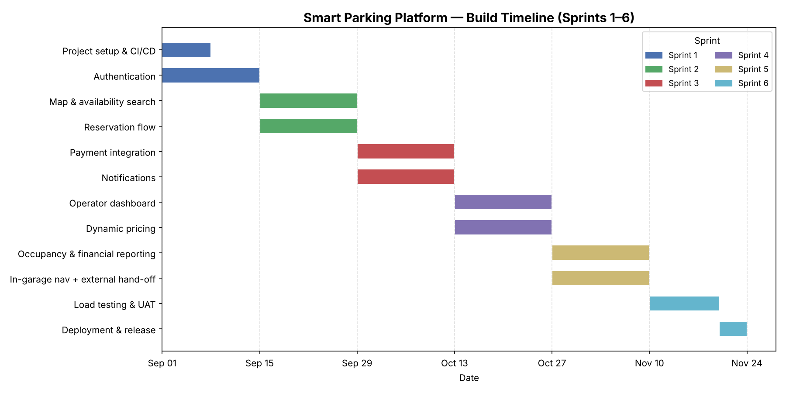
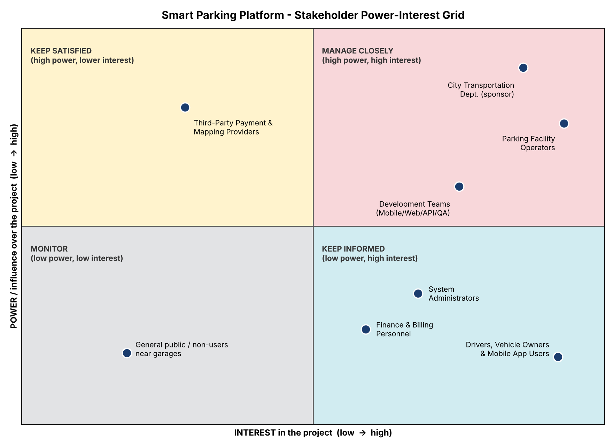
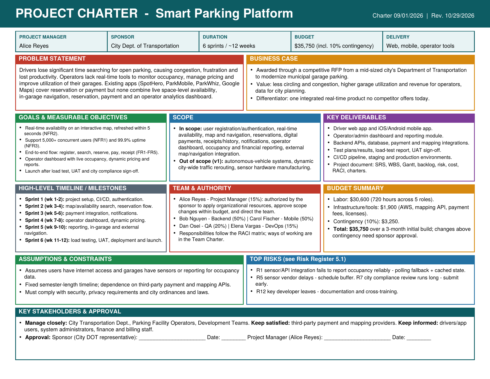
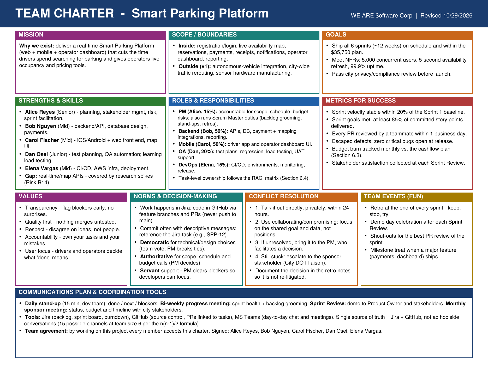

# Smart Parking Platform: Project Document
**Version:** 0.7
**Prepared by:** WE ARE $oftware ¢orp
**Date:** 09/09/2026

## Table of Contents
- [1. Research: Existing Software Landscape](#1-research-existing-software-landscape)
- [2. Vision and Scope](#2-vision-and-scope)
- [3. Software Requirements Specification](#3-software-requirements-specification-srs)
- [4. Project Planning](#4-project-planning)
- [5. Risk, Quality, and Communication Management](#5-risk-quality-and-communication-management)
- [6. Resource & Cost Management](#6-resource--cost-management)
- [7. Team & Stakeholder Management](#7-team--stakeholder-management)

## 1. Research: Existing Software Landscapes

Several parking solutions already exist in the market:

- **SpotHero** – Lets drivers pre-book parking spots at garages and lots in
  major cities. Strong on reservation/payment, weak on real-time availability
  (relies on operator-reported inventory, not live sensors).
- **ParkMobile** – Focuses on paying for on-street meter parking via phone.
  Good for street parking, does not address garage navigation or reservations.
- **ParkWhiz** – Similar to SpotHero; marketplace model for pre-booked parking,
  little to no live occupancy or in-garage navigation features.
- **Google Maps (parking layer)** – Shows general area difficulty ("limited
  parking") but no real per-spot availability, no reservation, no payment.

**How Smart Parking Platform differs:** unlike the above, our platform combines
*real-time* space-level availability, in-garage navigation, reservation, and
payment in one system, plus a dedicated operator dashboard for occupancy
analytics — something none of the above offer as a single integrated product.

## 2. Vision and Scope

### 2.1 Project Acquisition
This project was acquired by WE ARE $oftware ¢orp after being awarded a
contract through a competitive RFP process issued by a mid-sized city's
Department of Transportation, seeking to modernize parking availability
across its municipal parking garages.

### 2.2 About WE ARE $oftware ¢orp
WE ARE $oftware ¢orp is a fictitious software development studio specializing
in civic and mobility technology, with the resources to deliver full-stack
web, mobile, and backend solutions for municipal and commercial clients.

### 2.3 Project Overview
The Smart Parking Platform will allow drivers to locate, reserve, and pay for
parking in real time via web and mobile apps, while giving parking operators
a dashboard to monitor occupancy, pricing, and utilization.

### 2.4 Scope
**In scope:** user registration, real-time availability, map/navigation,
reservations, payments, operator dashboard, notifications.
**Out of scope (v1):** integration with autonomous vehicle systems, dynamic
city-wide traffic rerouting, hardware sensor manufacturing.

## 3. Software Requirements Specification (SRS)
Project: Smart Parking Platform
Version: 0.1
Date: [09/09/2026]

### 3.1 Introduction
**Purpose:** This document defines the requirements for the Smart Parking
Platform.
**Scope:** See Vision & Scope section above.

### 3.2 Overall Description
- **Users:** Drivers, parking operators, city administrators, finance staff
- **System Environment:** Web application + mobile app (iOS/Android)
- **Constraints:** Must comply with city data privacy ordinance; must
  integrate with third-party payment processors and mapping APIs
- **Assumptions:** Users have internet access; garages have sensors or
  reporting mechanisms for occupancy data

### 3.3 Functional Requirements 
- FR1: The system shall allow users to register and log in securely.
- FR2: The system shall display real-time parking availability on a map.
- FR3: The system shall allow users to reserve a parking space.
- FR4: The system shall process digital payments for reservations.
- FR5: The system shall generate a digital receipt after each transaction.

### 3.4 Non-Functional Requirements 
- NFR1: The system shall support at least 5,000 concurrent users.
- NFR2: Availability data shall refresh within 5 seconds.
- NFR3: The system shall maintain 99.9% uptime.

### 3.5 Use Cases 

**UC1 — Reserve a Parking Space**
- Actor: Driver
- Precondition: User is logged in
- Steps: 1) User searches for garage 2) Selects available spot 3) Confirms
  reservation 4) System processes payment 5) Confirmation sent
- Postcondition: Spot is held for user's arrival window

**UC2 — View Real-Time Occupancy (Operator)**
- Actor: Parking Operator
- Precondition: Operator is logged into admin dashboard
- Steps: 1) Operator opens dashboard 2) System displays live occupancy per
  level/zone 3) Operator filters by garage
- Postcondition: Operator has current occupancy snapshot

**UC3 — Cancel a Reservation**
- Actor: Driver
- Precondition: User has an active, unexpired reservation
- Steps: 1) User opens "My Reservations" 2) Selects the reservation to cancel
  3) Confirms cancellation 4) System releases the held spot 5) System issues
  refund per cancellation policy
- Postcondition: Spot is released back to availability; reservation marked
  "Cancelled"

**UC4 — Register a New Account**
- Actor: Driver
- Precondition: User does not have an existing account
- Steps: 1) User selects "Sign Up" 2) Enters email, password, basic profile
  info 3) System sends verification email 4) User verifies email 5) Account
  activated
- Postcondition: User has an authenticated, active account

**UC5 — Navigate to Reserved Spot In-Garage**
- Actor: Driver
- Precondition: User has an active reservation and has arrived at the garage
- Steps: 1) App detects user is on-site (geofence/QR check-in) 2) App displays
  in-garage directions to assigned level/zone 3) User follows wayfinding to spot
- Postcondition: User is routed to their reserved spot

**UC6 — Pay via Saved Payment Method**
- Actor: Driver
- Precondition: User has at least one saved payment method on file
- Steps: 1) User reaches checkout during reservation 2) Selects saved card/
  wallet 3) Confirms charge amount 4) System processes payment via processor
  5) Receipt generated
- Postcondition: Payment is captured and linked to the reservation

**UC7 — Receive Low-Availability Notification**
- Actor: Driver
- Precondition: User has enabled notifications for a garage/area
- Steps: 1) System monitors occupancy for watched garage 2) Occupancy crosses
  low-availability threshold 3) System pushes notification to user's device
- Postcondition: User is alerted before the garage fills up

**UC8 — Set Dynamic Pricing (Operator)**
- Actor: Parking Operator
- Precondition: Operator is logged into admin dashboard and owns the garage
- Steps: 1) Operator opens pricing settings for a garage 2) Adjusts rate
  rules (time-of-day, demand-based) 3) Saves changes 4) System applies new
  rates to future reservations
- Postcondition: Updated pricing is live for the garage

**UC9 — Generate Occupancy Report (Operator)**
- Actor: Parking Operator
- Precondition: Operator is logged into admin dashboard
- Steps: 1) Operator selects garage and date range 2) System aggregates
  occupancy data 3) Report is rendered as chart/table 4) Operator exports
  report (PDF/CSV)
- Postcondition: Operator has a historical occupancy report

**UC10 — Extend an Active Reservation**
- Actor: Driver
- Precondition: User has an active reservation that is not yet expired and
  the spot has no conflicting booking
- Steps: 1) User opens active reservation 2) Selects "Extend" 3) System checks
  spot availability for extended window 4) System charges additional time
  5) Reservation window updated
- Postcondition: Reservation end time is extended

**UC11 — View Reservation History**
- Actor: Driver
- Precondition: User is logged in and has at least one past reservation
- Steps: 1) User opens "My Reservations" 2) Selects "History" tab 3) System
  displays past reservations with receipts
- Postcondition: User can view/download past reservation records

**UC12 — Report a Parking Issue**
- Actor: Driver
- Precondition: User has an active or recent reservation
- Steps: 1) User selects "Report an Issue" 2) Chooses issue type (e.g., spot
  occupied by another vehicle) 3) Adds description/photo 4) Submits report
  5) System routes ticket to operator
- Postcondition: Operator receives a logged issue ticket for the garage

**UC13 — Integrate with External Navigation App**
- Actor: Driver
- Precondition: User has selected a garage/spot and has a navigation app
  installed
- Steps: 1) User selects "Navigate" 2) System hands off destination
  coordinates to external app (e.g., Google Maps/Waze) via deep link
  3) External app opens with route pre-loaded
- Postcondition: User is routed to the garage via their preferred navigation
  app

**UC14 — Add a Vehicle to Profile**
- Actor: Driver
- Precondition: User is logged in
- Steps: 1) User opens profile settings 2) Selects "Add Vehicle" 3) Enters
  make/model/plate number 4) Saves vehicle
- Postcondition: Vehicle is available for selection during future reservations

**UC15 — Process a Refund (Finance staff)**
- Actor: Finance and Billing Personnel
- Precondition: A cancelled or disputed reservation exists with a captured
  payment
- Steps: 1) Finance staff opens the transaction in the admin finance panel
  2) Verifies refund eligibility per policy 3) Issues refund 4) System
  notifies payment processor and updates transaction status
- Postcondition: Refund is issued and reservation marked "Refunded"

## 3.6 User Stories

| ID | As a... | I want to... | So that... | Related FR/UC |
|----|---------|---------------|------------|----------------|
| US1 | Driver | register and log in securely | I can access my account and saved info | FR1, UC4 |
| US2 | Driver | see real-time parking availability on a map | I can find an open spot without circling the garage | FR2, UC1 |
| US3 | Driver | reserve a specific spot | I can guarantee parking before I arrive | FR3, UC1 |
| US4 | Driver | pay digitally when I reserve | I don't have to carry cash or a physical ticket | FR4, UC6 |
| US5 | Driver | get a digital receipt | I have a record for expenses/reimbursement | FR5, UC1 |
| US6 | Driver | cancel a reservation I no longer need | I'm not charged for a spot I won't use | UC3 |
| US7 | Driver | get turn-by-turn directions inside the garage | I can find my reserved spot quickly | UC5 |
| US8 | Driver | be notified when a garage I'm watching is nearly full | I can decide to park elsewhere before it's too late | UC7 |
| US9 | Driver | extend my reservation | I'm not penalized if I need a few more minutes | UC10 |
| US10 | Driver | view my past reservations | I can track my parking spend over time | UC11 |
| US11 | Driver | report a problem with my spot | the operator can fix it instead of me losing the reservation | UC12 |
| US12 | Driver | open my reservation in my usual navigation app | I don't have to learn a new map interface | UC13 |
| US13 | Driver | save my vehicle info | I don't have to re-enter it every time I book | UC14 |
| US14 | Parking Operator | see live occupancy across my garages | I know when to adjust staffing or pricing | FR2, UC2 |
| US15 | Parking Operator | set dynamic pricing | I can maximize revenue during high-demand periods | UC8 |
| US16 | Parking Operator | generate occupancy reports | I can report utilization trends to the city | UC9 |
| US17 | Finance Staff | process refunds from a dedicated panel | I can resolve billing disputes without engineering help | UC15 |
| US18 | System Administrator | assign roles/permissions to operators | access stays scoped correctly across garages | WBS 2.2 |

## 4. Project Planning

### 4.1 Work Breakdown Structure (WBS)

1. Project Management & Planning — Owner: Alice (PM)
   1.1 Sprint planning & backlog grooming — 2d/sprint
   1.2 Stakeholder/status reporting — 1d/sprint

2. Authentication — Owner: Bob (Backend)
   2.1 Login (form, validation, error handling) — 3d
   2.2 Registration (account creation, email verification) — 3d
   2.3 Session management (tokens, auto-logout) — 2d

3. User / Operator Management — Owner: Bob (Backend)
   3.1 Driver account + profile (vehicle info, payment method) — 4d
   3.2 Operator account + role/permission assignment — 3d

4. Driver-Facing Platform — Owner: Carol (Mobile)
   4.1 Map search & real-time availability display — 5d
   4.2 Reservation flow (select, confirm, hold) — 5d
   4.3 Reservation management (extend, cancel, history) — 4d
   4.4 In-garage navigation / wayfinding — 4d
   4.5 External navigation app hand-off — 2d

5. Payments — Owner: Bob (Backend)
   5.1 Payment processor integration — 5d
   5.2 Saved payment methods — 2d
   5.3 Receipts & refund processing (finance panel) — 3d

6. Notifications — Owner: Carol (Mobile)
   6.1 Low-availability push alerts — 3d
   6.2 Reservation confirmations/reminders — 2d

7. Operator Dashboards — Owner: Carol (Mobile) / Bob (Backend)
   7.1 Add/edit/remove garage — 3d
   7.2 Real-time occupancy per garage — 4d
   7.3 Dynamic pricing controls — 4d
   7.4 Issue-report inbox — 2d

8. Reporting — Owner: Bob (Backend)
   8.1 Occupancy reporting (graphs, historical trends) — 4d
   8.2 Financial reporting (revenue by garage, export) — 4d

9. Testing & QA — Owner: Dan (QA)
   9.1 Unit/integration test coverage — ongoing, 2d/sprint
   9.2 Load testing (5,000+ concurrent users, NFR1) — 4d
   9.3 UAT with stakeholder sign-off — 3d

10. Deployment & Release — Owner: Elena (DevOps)
   10.1 CI/CD pipeline setup — 3d
   10.2 Staging & production environments — 3d
   10.3 Launch & rollback plan — 2d

Figure 1: Sprint 1 board showing the active sprint's To Do items.

Figure 2: Product backlog showing the remaining items not yet pulled into Sprint 1.

## 4.3 Product Backlog

| ID | Backlog Item | Priority | Story Points | Sprint Assigned | Status |
|----|---------------|----------|----------------|-------------------|--------|
| B1 | Login/Registration | Must | 5 | Sprint 1 | In Progress |
| B2 | Session management | Must | 3 | Sprint 1 | To Do |
| B3 | CI/CD pipeline setup | Must | 3 | Sprint 1 | In Progress |
| B4 | Map & real-time availability search | Must | 8 | Sprint 2 | To Do |
| B5 | Reservation flow (select/confirm/hold) | Must | 8 | Sprint 2 | To Do |
| B6 | Reservation management (cancel/extend/history) | Should | 5 | Sprint 2 | To Do |
| B7 | Payment processor integration | Must | 8 | Sprint 3 | To Do |
| B8 | Saved payment methods | Should | 3 | Sprint 3 | To Do |
| B9 | Low-availability notifications | Should | 5 | Sprint 3 | To Do |
| B10 | Operator garage management (add/edit/remove) | Must | 5 | Sprint 4 | To Do |
| B11 | Real-time occupancy dashboard | Must | 8 | Sprint 4 | To Do |
| B12 | Dynamic pricing controls | Should | 5 | Sprint 4 | To Do |
| B13 | Occupancy reporting | Should | 5 | Sprint 5 | To Do |
| B14 | Financial reporting & export | Should | 5 | Sprint 5 | To Do |
| B15 | In-garage navigation/wayfinding | Could | 5 | Sprint 5 | To Do |
| B16 | External navigation app hand-off | Could | 2 | Sprint 5 | To Do |
| B17 | Vehicle profile management | Could | 2 | Backlog (unscheduled) | To Do |
| B18 | Issue-report inbox (operator side) | Could | 3 | Backlog (unscheduled) | To Do |
| B19 | Refund processing panel (finance) | Should | 3 | Backlog (unscheduled) | To Do |
| B20 | Load testing (NFR1 — 5,000 concurrent users) | Must | 5 | Sprint 6 | To Do |

## 4.2 Project Timeline & Gantt Chart

Figure 3: Build timeline across Sprints 1–6, covering authentication through deployment.

*Priority: MoSCoW (Must/Should/Could/Won't). Items with no sprint assignment remain in the product backlog awaiting prioritization in a future sprint-planning session.*

## 5. Risk, Quality, and Communication Management

### 5.1 Risk Register

| ID | Category | Description | Probability | Impact | Risk Level | Owner | Response Strategy | Status/Notes |
|----|----------|--------------|-------------|--------|------------|-------|--------------------|---------------|
| R1 | Technical | Parking sensor/API integration fails to report real-time occupancy reliably | Moderate (3) | Major (4) | High | Backend Lead | Mitigate — build polling fallback + cached last-known state | Open |
| R2 | Technical | Third-party payment processor API has downtime or breaking changes | Low (2) | Major (4) | Medium | Backend Lead | Transfer — rely on processor's SLA; add retry/queue logic | Open |
| R3 | Technical | Mobile app fails on older iOS/Android versions | Moderate (3) | Minor (2) | Medium | Mobile Dev | Mitigate — define minimum supported OS versions early | Open |
| R4 | Technical | Database can't scale to support 5,000+ concurrent users (per NFR1) | Low (2) | Catastrophic (5) | Medium | Backend Lead | Mitigate — load testing before launch; cloud auto-scaling | Open |
| R5 | Schedule | Garage hardware/sensor vendor delays installation past planned date | Moderate (3) | Major (4) | High | Project Manager | Accept — build schedule buffer into timeline | Open |
| R6 | Schedule | Operator dashboard and driver app development dependencies slip (per WBS) | Moderate (3) | Moderate (3) | Medium | Project Manager | Mitigate — parallelize independent workstreams | Open |
| R7 | Schedule | City compliance/legal review takes longer than expected | Moderate (3) | Major (4) | High | Project Manager | Accept — submit compliance docs early in parallel with dev | Open |
| R8 | Schedule | Sprint 1 scope underestimated, pushing Sprint 2 start | Low (2) | Moderate (3) | Low | Scrum Master | Mitigate — track velocity after Sprint 1, adjust Sprint 2 scope | Open |
| R9 | Financial | Cloud hosting costs exceed budget due to higher-than-expected usage | Moderate (3) | Moderate (3) | Medium | Finance Lead | Mitigate — set usage alerts/budget caps on cloud provider | Open |
| R10 | Financial | City funding/contract renewal delayed, affecting payroll | Low (2) | Catastrophic (5) | Medium | Project Manager | Transfer — negotiate milestone-based payment terms in contract | Open |
| R11 | Financial | Third-party API/licensing costs increase mid-project | Low (2) | Minor (2) | Low | Finance Lead | Accept — minor cost, absorb into budget | Open |
| R12 | People | Key developer leaves mid-project (turnover) | Moderate (3) | Major (4) | High | Project Manager | Mitigate — maintain documentation, cross-train team members | Open |
| R13 | People | Team conflict over technical direction (e.g., architecture disagreements) | Low (2) | Moderate (3) | Low | Scrum Master | Mitigate — regular retrospectives, clear decision-making process | Open |
| R14 | People | Skill gap — team lacks experience with real-time data/map APIs | Moderate (3) | Moderate (3) | Medium | Project Manager | Mitigate — allocate time for research spikes/training | Open |

*Risk Level derived from the course's Risk Matrix (Probability × Impact).*

### 5.2 Communication Plan

**Meeting Cadence**

| Meeting | Frequency | Attendees | Purpose |
|---------|-----------|-----------|---------|
| Daily Stand-up | Daily | Dev team | Short status sync — what was done, what's next, blockers |
| Sprint/Progress Meeting | Bi-weekly | Dev team + Scrum Master | Deeper check-in on sprint progress, backlog grooming |
| Sprint Review | End of each sprint | Full team + Product Owner | Demo completed work, gather feedback |
| Stakeholder/Sponsor Meeting | Monthly | Project Manager, city stakeholders | Big-picture progress update, budget/timeline check-in |

**Reporting Methods by Audience**

- **Executives / City Stakeholders:** High-level status reports and dashboards — overall timeline, budget burn, key risks, milestone progress (no technical detail).
- **Developers / Technical Team:** Detailed task-level updates via the Jira board (backlog, sprint board, burndown).
- **Operators / End Users (future phase):** Release notes and demo videos when new features ship.

**Team Size & Communication Channels**

Using the formula from class — n(n-1)/2 — for a team of 6 (PM, Scrum Master, 2 backend devs, 1 mobile dev, 1 QA):
6(6-1)/2 = **15 potential communication channels**. This is why structured cadences (stand-ups, sprint reviews) and a single source of truth (Jira + GitHub) are used instead of ad hoc one-off conversations.

## 6. Resource & Cost Management

### 6.1 Roles & Resources

| Role | Name | Skill Level | FTE % Allocation |
|------|------|-------------|-------------------|
| Project Manager | Alice Reyes | Senior | 15% |
| Backend Developer | Bob Nguyen | Mid-level | 50% |
| Mobile Developer | Carol Fischer | Mid-level | 50% |
| QA / Tester | Dan Osei | Junior | 20% |
| DevOps/Infra | Elena Vargas | Mid-level | 15% |

### 6.2 Resource & Cost Plan (Bottom-Up)

**Project assumptions:** 5-person team, 3-month initial build phase (matching Sprint 1-3 timeline).

| Role | Name | FTE % | Estimated Hours | Hourly Rate | Cost |
|------|------|-------|------------------|-------------|------|
| Project Manager | Alice | 0.15 | 72 | $45 | $3,240 |
| Backend Developer | Bob | 0.50 | 240 | $45 | $10,800 |
| Mobile Developer | Carol | 0.50 | 240 | $42 | $10,080 |
| Tester | Dan | 0.20 | 96 | $30 | $2,880 |
| DevOps | Elena | 0.15 | 72 | $50 | $3,600 |
| **TOTAL** | | | **720** | | **$30,600** |

**Infrastructure & Other Costs**

| Item | Category | Qty/Months | Unit Cost | Duration | Total | Notes |
|------|----------|------------|-----------|----------|-------|-------|
| Cloud hosting (AWS) | Infra | 3 months | $250/month | 3 | $750 | EC2 + S3, matches current AWS setup |
| Mapping/Navigation API | Third-party API | 3 months | $150/month | 3 | $450 | Real-time map/navigation data |
| Payment processor fees | Third-party API | 3 months | $100/month | 3 | $300 | Transaction processing |
| Dev tools & licenses | Tools | one-off | $400 | N/A | $400 | Jira, GitHub, IDE licenses |
| **Subtotal (Infra)** | | | | | **$1,900** | |

**Grand Total**

| | Amount |
|---|--------|
| Labor subtotal | $30,600 |
| Infrastructure subtotal | $1,900 |
| Total before contingency | $32,500 |
| Contingency (10%) | $3,250 |
| **Grand Total** | **$35,750** |

### 6.3 Budgeted Cashflow (Monthly)

| Month | Labor | Infra | Licenses | Contingency (10%) | Total |
|-------|-------|-------|----------|---------------------|-------|
| Month 1 | $10,200 | $250 | $400 | $1,085 | $11,935 |
| Month 2 | $10,200 | $250 | $0 | $1,045 | $11,495 |
| Month 3 | $10,200 | $250 | $0 | $1,045 | $11,495 |
| **Total** | **$30,600** | **$750** | **$400** | **$3,175** | **~$34,925** |

*Note: Third-party API costs ($450 mapping + $300 payment = $750) are usage-based and billed starting Month 2 once integrations go live, so they're folded into the contingency buffer above rather than a fixed monthly line.*

### 6.4 RACI Matrix

| Task | PM (Alice) | Backend Dev (Bob) | Mobile Dev (Carol) | QA (Dan) | DevOps (Elena) |
|------|------------|--------------------|----------------------|----------|------------------|
| Requirements (SRS) | A | C | C | I | I |
| Architecture / System Design | A | R | C | I | C |
| Backend API Implementation | C | R | I | C | I |
| Mobile/Frontend Implementation | C | I | R | C | I |
| Database Design | C | R | I | I | C |
| Testing | I | C | C | A/R | I |
| Deployment / Release | C | C | I | I | A/R |
| Reporting Dashboard | C | R | I | C | I |

*R = Responsible, A = Accountable, C = Consulted, I = Informed*

## 7. Team & Stakeholder Management

### 7.1 Stakeholder Analysis (Power-Interest Grid)

Stakeholders were identified from the project brief and requirements elicitation, then placed on a Power-Interest Grid to decide how much engagement each one needs.

Figure 4: Power-Interest Grid for the Smart Parking Platform.

| Stakeholder | Power | Interest | Strategy | How we engage them |
|-------------|-------|----------|----------|--------------------|
| City Transportation Dept. (sponsor) | High | High | Manage closely | Monthly sponsor meeting, milestone sign-offs, compliance review |
| Parking Facility Operators | High | High | Manage closely | Sprint Reviews, early dashboard demos, requirements input |
| Development Teams (Mobile/Web/API/QA) | Medium-High | High | Manage closely | Daily stand-ups, Jira board, sprint planning/retros |
| Third-Party Payment & Mapping Providers | High | Low-Medium | Keep satisfied | Follow API terms/SLAs, early sandbox testing, monitor change notices |
| System Administrators | Medium | High | Keep informed | Release notes, admin training, access/permission reviews |
| Finance & Billing Personnel | Low-Medium | High | Keep informed | Refund/receipt workflow demos, financial report previews |
| Drivers, Vehicle Owners & Mobile App Users | Low (individually) | High | Keep informed | Release notes, demo videos, in-app feedback, beta testing |
| General public near garages | Low | Low | Monitor | Periodic check via city channels; no active engagement |

Key takeaway: the city, operators and dev team get the most PM attention. Payment/mapping providers are the biggest external dependency (Risks R2, R11), so we keep them satisfied rather than closely engaged.

### 7.2 Project Charter

Figure 5: Project Charter authorizing the Smart Parking Platform project.

### 7.3 Team Charter

Figure 6: Team Charter defining how the team operates.
